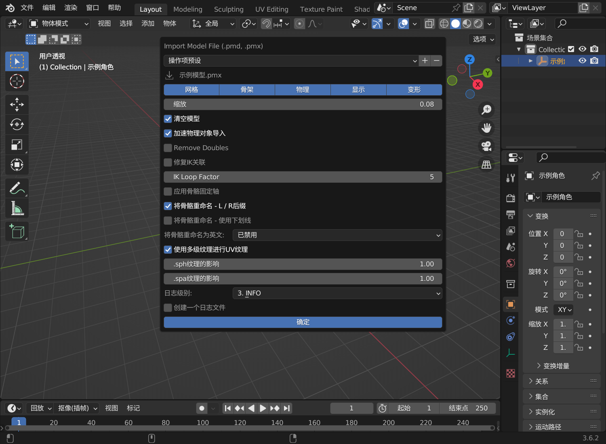
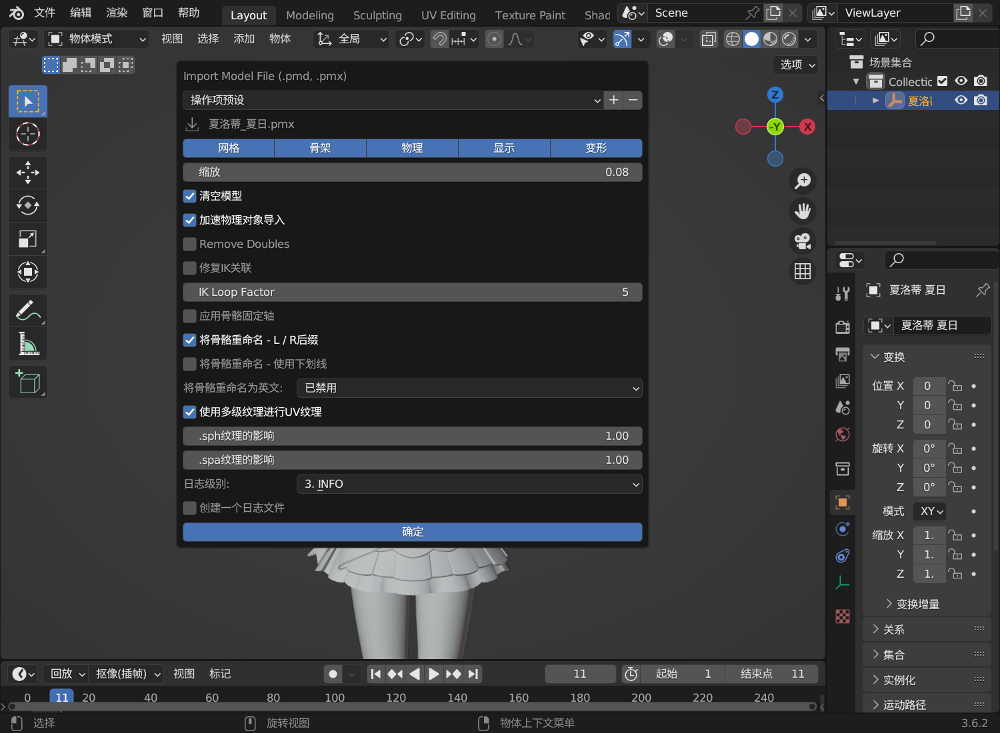
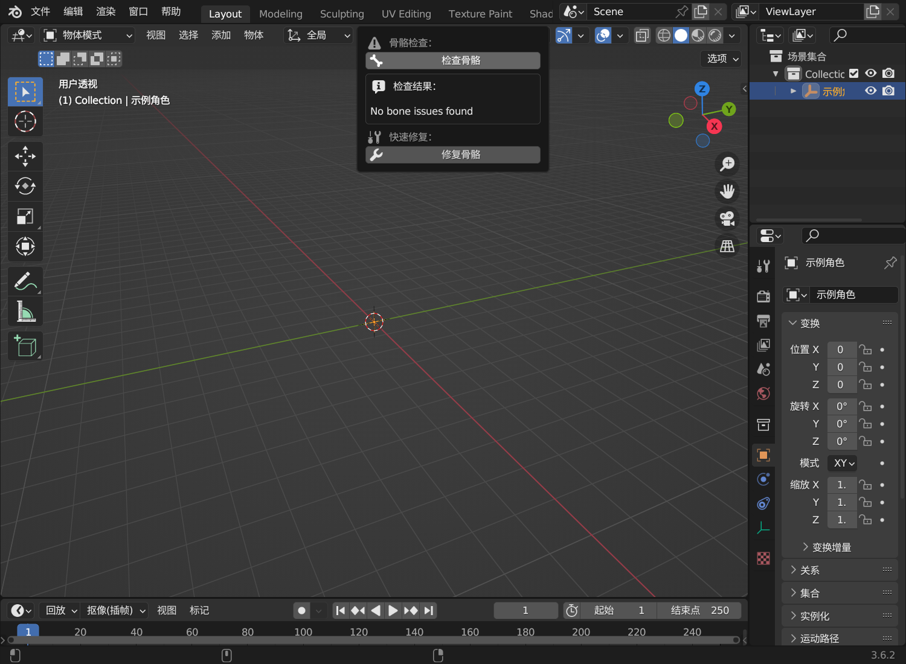
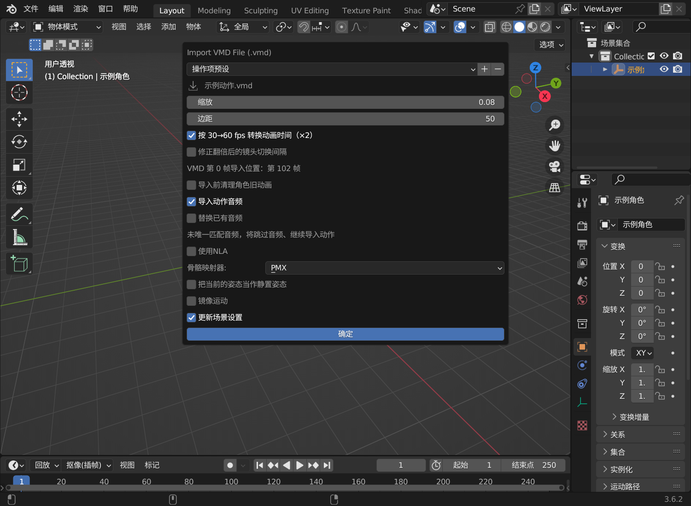
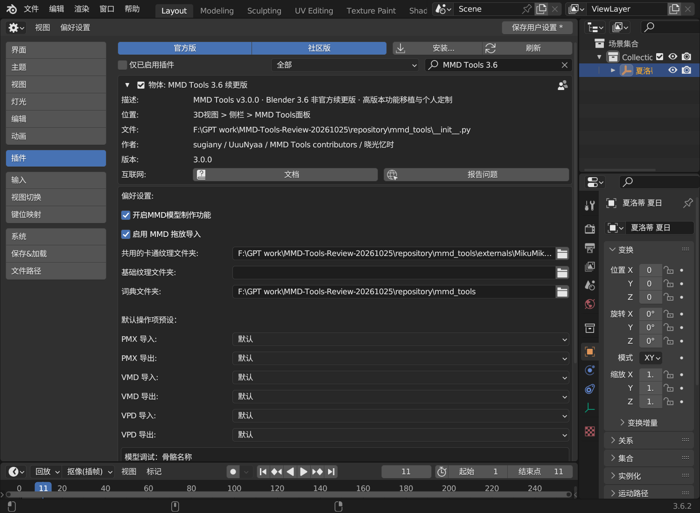
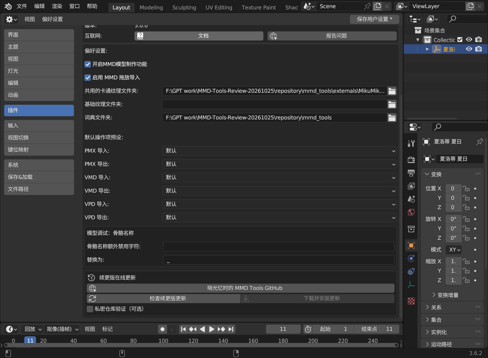

# MMD Tools 3.6 续更版

**MMD Tools v3.0.0 · 适用于 Blender 3.6 · 基于 MMD Tools 2.10.3**

发布标题：**MMD Tools 3.6 非官方续更版——高版本功能移植与个人定制**

## 这是什么插件？

MMD Tools 用于在 Blender 中导入和导出 MMD 模型、动作与姿态，例如 PMX 模型、VMD 动作和 VPD 姿态。

原版面向 Blender 3.6 的分支停止维护后，本版以 2.10.3 为基础，把部分高版本 MMD Tools 的功能移植回来，并加入制作过程中按个人使用需求编写的功能和修改。希望继续使用 Blender 3.6 的用户，可以保留熟悉的工作方式（本版没有移植最新版mmdtools的动作导入逻辑），同时使用这里列出的新增功能。

这是**非官方续更版**，不是高版本 MMD Tools 的完整移植。“个人定制”表示修改来自特定使用需求，不代表每一项都适合所有人的工作流程；个人定制的新增操作默认关闭，可按需使用。

## 与原版有什么不同？

原版的模型、材质、物理、表情和动作导入导出仍然保留，主要增加以下内容：

| 来源 | 主要内容 |
| --- | --- |
| **从高版本移植** | 默认操作预设、骨骼名称检查与修复、附加旋转修复、按贴图合并材质、表情滑块的日英名称显示、全部表情批量插帧 |
| **参考高版本交互，在 3.6 上重新适配** | 从 Windows 资源管理器拖入 MMD 文件后，直接打开对应导入设置；内部接收方式与高版本不同 |
| **本版个人定制与修复** | VMD 导入时间 ×2（制作原生60帧视频）、可选镜头切换间隔修正、角色旧动画清理、同目录音频导入、物理对象导入提速、VMD 导出部分冗余帧修复、预设保存恢复等 |

这里的“本版定制”用于区别于本项目从上游移植的部分，不表示其他插件从未实现类似功能。完整差异表和各项 GitHub 依据在文章后半部分。

**适用环境：** Blender 3.6；实际验证使用 Windows / Blender 3.6.2 + SSGI Native。拖放功能仅支持 Windows。其他系统可使用文件菜单导入，但本版未在其他系统完成验证。

## 阅读导航

- [安装与第一次导入](#start)
- [拖放、模型调试与材质合并](#model-tools)
- [动作、镜头、旧动画清理与音频](#motion-options)
- [默认操作预设](#presets)
- [附加旋转、表情及其他工具](#tools)
- [完整功能差异](#differences)
- [各项移植与高版本的实现区别](#backport-differences)
- [常见问题](#faq)

## 安装

1. 下载发布附件中的 `MMD-Tools-3.6-Continued-v3.0.0.zip` **插件安装包**，不要解压。
2. 在 Blender 的「编辑 → 偏好设置 → 插件 → 安装」中选择该 ZIP，启用 **MMD Tools 3.6 续更版**。
3. 安装或升级后重启 Blender，再打开工程。

本版沿用 `mmd_tools` 模块名，作为原版的替换版本安装，不能与另一个同名 MMD Tools 同时启用。

`Source` 源码包用于浏览代码或建立 GitHub 仓库，不是直接安装包。更新入口已连接[晓光忆时的续更版 GitHub 仓库](https://github.com/DmXgDr/mmd-tools-3.6-continued)。在插件偏好设置底部点击「检查续更版更新」，发现新版本后点击「下载并安装更新」。下载校验成功后才替换插件，原插件目录会备份；请保存工程后重启 Blender。也可以点击仓库链接手动下载。

## 第一次导入

### 模型

将 `.pmx` 或 `.pmd` 从资源管理器拖入 3D 视图，检查导入设置后确认即可，不需要预先选择对象。也可以通过「文件 → 导入」使用相同导入器。

*模型导入窗口。上方选择需要导入的网格、骨架、物理等内容；「加速物理对象导入」是本版新增选项。*

### Windows 拖放导入

*示例使用夏洛蒂模型。将 PMX 从文件管理器拖入 3D 视图后，直接出现模型导入设置；确认参数后再导入。*

支持 PMX、PMD、VMD、VPD。可拖入 3D 视图或处于「视图层」显示模式的大纲视图；连续的同类、同目录文件可分组处理。使用原导入器设置窗口。

在「编辑 → 偏好设置 → 插件」中搜索“续更版”，展开插件后，可随时关闭「启用 MMD 拖放导入」，文件菜单导入仍可使用。同一批拖入文件混有不支持格式时，整批交回 Blender 原有处理。

### 模型调试：骨骼名称检查与修复

选中 MMD 模型，在 3D 视图侧栏的 **MMD → 模型调试** 中点击「检查骨骼」，阅读结果后按需点击「修复骨骼」。

检查内容包括：

- 名称是否重复。
- 是否包含 CP932 无法表示的字符。
- CP932 编码后是否超过 15 字节。
- 是否包含用户指定的额外禁用字符。

检查本身不修改模型。它不是 IK、权重、穿模或物理稳定性检查；15 字节规则用于传统 MMD/VMD 名称兼容，不表示 PMX 格式本身不能保存长名称。

### 修复骨骼

点击 **修复骨骼** 后，插件按规则转换中文字形、过滤不能编码的字符、截短超长名称，并使用数字后缀处理重名。自定义禁用字符按偏好设置替换或删除。

修复只修改骨骼的 **MMD 日文名称**，不修改 Blender 骨骼名称，不重建层级、约束、权重或物理。支持 **Ctrl+Z** 撤销。修复后可以再次点击检查确认结果，再保存工程。

使用 PMX 名称映射的 VMD 会受到 MMD 骨骼改名的影响。外部动作文件不会同时改写，因此应根据模型实际用途决定是否修复名称。

### 自定义禁用字符

打开“编辑 → 偏好设置 → 插件 → MMD Tools”，找到“模型调试：骨骼名称”：

- **骨骼名称额外禁用字符**：默认留空，按每个字符检查，不是正则表达式。
- **替换为**：默认 `_`，最多一个字符；留空表示删除。

这两项是普通插件偏好设置，按 Blender 的偏好设置保存方式保留，不属于导入窗口的临时参数记忆。特殊替换组合仍可能留下名称或长度问题，可再次检查确认。

如果找不到模型调试面板，确认 MMD Tools 偏好设置中的 **Enable MMD Model Production Features / 启用 MMD 模型制作功能** 已开启。

*为便于阅读，图中单独弹出了同一个骨骼检查面板。正常入口是 MMD 侧栏的「模型调试」；示例结果为未发现名称问题。*

### 查看报告

面板显示最近一次检查或修复报告，最多 10 行。更多内容可通过 Blender 的“窗口 → 切换系统控制台”查看。报告文本使用英文，主要含义如下：

| 提示                              | 含义             |
| ------------------------------- | -------------- |
| Duplicate bone name             | MMD 骨骼名重复      |
| exceeds 15 bytes in cp932       | 编码后的名称超过 15 字节 |
| cannot be encoded in cp932      | 包含无法编码的字符      |
| additional unallowed characters | 包含自定义禁用字符      |
| No bone issues found            | 未发现本功能检查范围内的问题 |
| Fixed bone name: A -> B         | 已将名称 A 修改为 B   |

报告不会随角色选择自动更新。切换角色后请再次点击检查。

### 按贴图合并材质

移植按贴图路径合并材质的工具。用于选中网格中**只有一个图像纹理节点、且贴图路径相同**的材质，通常先**转换为 Blender 材质**再使用。

使用步骤：选中要处理的网格，在模型设置中找到「转换为 Blender 材质」旁的合并图标。确认符合条件后执行，并检查合并后的外观；不合适时撤销。

它不比较粗糙度、透明度或完整节点效果；同贴图不代表视觉效果相同。请检查候选材质后使用，操作可撤销。本版工具提示已明确这项范围。

### 人物动作和表情

先选中接收对象，再拖入 `.vmd`：

| 选中的对象 | 适用操作 |
| --- | --- |
| MMD 角色最上层根空物体 | 给整个角色导入动作与表情；可以启用本版的旧动画清理、动作音频功能 |
| 角色骨架 | 只向骨架导入骨骼动作 |
| 表情控制用的 `.placeholder` | 向已绑定的表情控制器导入表情 |
| 具有形态键的角色网格 | 使用原导入器向网格导入对应表情 |

`.placeholder` 由 MMD Tools 的表情绑定生成，需要先在mmdtools中装配变形。能否匹配骨骼、形态键及表情名称，仍由原导入器和模型结构决定。

没有选择对象时，VMD/VPD 拖放会提示选择接收对象；模型导入不受此限制。

### 镜头动作与姿态

镜头 VMD 请选中实际的 **Camera 相机对象**，不要仅选择上层 `MMD_Camera` 空物体，然后拖入文件。相机的具体转换、动画写入由 MMD Tools 原导入器执行。

VPD 姿态文件也可拖入，使用原有 VPD 导入设置。本文的 60 fps 转换和动作音频功能用于 **VMD 导入**。

## 新增导入选项

| 选项 | 公开版默认值 | 作用 |
| --- | --- | --- |
| 按 30→60 fps 转换动画时间（×2） | 当前工程实际帧率为 60 时勾选，其他情况不勾选 | 以时间线第 0 帧为基准，将本次新导入动画的关键帧与手柄时间乘 2 |
| 修正翻倍后的镜头切换间隔 | 关闭 | 在时间翻倍后处理推断出的切镜间隔；只在转换开启时可用 |
| 导入前清理角色旧动画 | 关闭 | 对选中的 MMD 角色根对象执行更完整的骨骼、表情动画清理 |
| 导入动作音频 | 关闭 | 查找 VMD 同目录音频并放入序列编辑器 |
| 替换已有音频 | 关闭 | 音频导入成功后删除原有声音条带；不勾选时新增到空闲音轨 |

*示例工程为 60 fps，边距手动设为 50，因此 VMD 第 0 帧对应第 102 帧。图中为了展示音频相关设置，手动开启了「导入动作音频」；它并非默认开启。*

### 时间转换如何计算

***60帧处理和镜头切换间隔修正依据请先看RC的这期视频https://www.bilibili.com/video/BV153411A7aT/  4:48处开始***

例如边距为 50，原导入器把 VMD 第 0 帧放到 Blender 第 51 帧；开启转换后放到第 **102 帧**，其他关键帧及曲线手柄一起按第 0 帧缩放。窗口会显示「VMD 第 0 帧导入位置」。这个数值是源文件第 0 帧的对应位置，不保证源文件恰好在第 0 帧有关键帧。

每次打开导入窗口都会重新检查工程实际帧率（帧率除以基数），不会沿用上一个 60 fps 工程的勾选状态。24、25、30、59.94 等帧率不会自动勾选；这不是任意帧率转换工具。

**VMD 没有可用于可靠识别“已经翻倍”的帧率标记。** 如果文件本身已按 60 fps 编排，请手动取消转换，避免再次翻倍。用户指定的默认操作预设若明确保存了这个选项，则以预设为准；在本次窗口中仍可修改。

原有「更新场景设置」仍然有效：勾选它时，普通导入按原逻辑设置 30 fps，开启本版时间转换时设置 60 fps。若要保持工程帧率不变，请取消「更新场景设置」。**时间转换不改变导出选项，也不会在导出时自动除以 2。**

### 镜头切换间隔修正

普通、稀疏镜头中，源文件相邻两帧只差 1 帧，翻倍后会相差 2 帧；开启修正会将后一帧前移 1 帧，并同时处理 `MMD_Camera` 与实际 Camera 的动画。

对连续逐帧烘焙段，改用位置、旋转、距离、视角及透视变化推断明显跳变，避免把连续运动全部当成切镜。VMD 没有明确的“切镜”标记，推断可能与作者意图不同，因此默认关闭。确有切镜间隔问题时再开启，并检查切镜附近的播放结果。

### 清理角色旧动画

**仅选择 MMD 角色根空物体时显示**、执行这一选项；只选骨架或 `.placeholder` 时不显示。启用后：

- 清理该角色骨骼动画通道，包括相关 NLA 条带中的骨骼动画。
- 执行姿态的「清空变换 → 全部」和「重置非关键帧」，并复位骨骼姿态。
- 清理角色网格及表情控制器中已参与动画的形态键通道，并把这些形态键数值归零。
- 没有动画通道、但人为设置了数值的形态键不随之归零；表情驱动绑定保留。
- 随后的 VMD 导入同样保留现有表情驱动器：它替换或添加动画 Action，不清空整个动画数据，也不解除变形绑定。导入到角色根对象时，会同时处理网格与已绑定的 `.placeholder`；驱动器仍按控制器数值工作。
- 处理共享动画/网格时尽量隔离当前角色，避免同时清理其他使用者；内部姿态复位期间暂时关闭自动插帧，完成后恢复。

这是覆盖旧动作前的额外清理，会移除之前手工修改的相关动画。默认关闭只表示不执行本版的强化清理，**不代表原导入器会合并或保留所有旧动作**。需要保留修好的动作时，先另存工程。

### 动作音频

同样只在选中的角色根空物体导入动作时生效。音频来自 VMD 所在目录，而非 VMD 文件本身：

1. 优先选择与 VMD 文件主名一致的音频。
2. 没有同名音频时，目录内只有一个候选音频则使用它。
3. 无法唯一确定时跳过自动导入；可在导入窗口选择具体候选文件。

音频放在该次动作的起始偏移位置；边距和 ×2 转换都会计入，不对音频本身变速。默认在空闲音轨新增，不删除工程现有声音。多音频、音频缺失或读取失败不会把已成功导入的动作判为失败。

只有明确勾选「替换已有音频」时，才在新音频成功建立后移除原有声音条带，**包括对白、音效及嵌套条带内的声音**；视频和其他非声音条带保留。新音频导入失败时保留原有声音。

## 默认预设与本次会话记忆

在导入/导出窗口中调整选项后，可通过顶部操作项预设的 `+` 保存自己的预设。随后在「偏好设置 → 插件 → MMD Tools → 默认操作项预设」中，为 PMX、VMD、VPD 的导入/导出分别指定默认预设。

- 默认选择按预设名称保存，不因列表排序变化而串到其他项。
- 选择信息与选中预设的内容备份保存在 Blender 用户配置目录的 `mmd_tools_public/default_operator_presets.json`，替换插件代码后仍可恢复。
- 拖放窗口中成功导入使用的其他参数在当前 Blender 会话内记忆；重新启动后重新从默认预设/内置值开始。
- 修改默认预设会让下一次调用重新读取预设。时间转换选项每次按场景重新计算，除非预设明确指定它。

*插件偏好设置：六项操作预设均为「默认」。路径随安装位置变化，不需要照抄图中的路径。*

本版不会删除用户已经创建的预设文件；升级用户可能仍会在列表中看到自己以前保存的预设。若希望恢复内置行为，把六项默认操作预设改回「默认」。

## 其他功能的详细用法

### 附加旋转修复

这部分的作用可以看rint大佬的专栏

https://www.bilibili.com/opus/1131140862183473152

https://www.bilibili.com/opus/1136168885950611460

移植高版本附加旋转约束的相关处理，MMD 骨骼可以继承其他骨骼的一部分旋转，这类关系常称为“赋予亲”或“附加旋转”。本插件修正多轴旋转叠加和负赋予率抵消时的组合方式。

新导入的模型自动使用修正后的约束，不需要额外点击按钮。

已经保存的**旧模型**可使用模型工具中的「**修复旧模型赋予亲**」更新已有约束，无需重新导入整个角色。

使用步骤：

1. 选中需要处理的 MMD 角色。
2. 打开 MMD 侧栏中的模型设置，在组装相关区域找到「修复旧模型赋予亲」。
3. 点击修复后，检查原先异常的旋转帧；已有约束会被更新，无需删除整个模型。

这与上述骨骼名称检查是两个独立功能。它不修正 VMD 与角色骨骼命名不匹配，也不是重新绑定动作。

### 表情滑块与批量插帧

移植高版本的表情滑块布局、日文/英文名称显示开关，以及「为全部表情注册关键帧」操作。先完成 MMD 表情绑定，再在相应表情面板调整和插帧。

使用步骤：

1. 选中角色，在模型设置的组装区域点击「变形 / Morph」完成表情绑定。
2. 在 MMD 表情面板选择表情、调整滑块数值，按需开启日文名或英文名显示。
3. 将时间线移动到需要插帧的位置，执行「Register All Morphs / 为全部表情注册关键帧」。若面板中不易找到，也可用 F3 搜索英文操作名称。
4. 按 F9 打开最后操作设置，可勾选「Skip Unchanged / 跳过未变化」并调整容差。

“全部表情”针对已绑定的表情控制滑块，包含可通过该系统控制的不同表情类型，不是给所有网格形态键无条件插帧。操作后可通过 F9 调整「跳过未变化」及容差。

### 模型导入提速

新增「加速物理对象导入」选项，默认启用。通过复用创建模板和批量构建减少刚体、关节创建过程的开销，目标是保留物理参数、对象归属及模型数据。它不是物理简化或烘焙，也不承诺播放、渲染速度提升。遇到特殊模型时可关闭此选项使用常规创建路径。

如果使用新版mmd桥流程，我建议导入模型时直接取消选择 **物理** 选项

### VMD 导出冗余帧修复

修正原导出器在部分恒定区间多插入“结束前一帧”的情况：仅在该通道数值确实变化、需要表示跳变时保留相应补帧。适用于使用该公共曲线转换路径的相机、骨骼和表情导出。

这不是动作简化器，不会随意删除用户关键帧，也不移除表达真实跳变或曲线插值所必需的采样。因此导出关键帧数仍可能与 Blender 界面显示的数量不同。之前已经导出到 VMD 的冗余帧不会被自动认定并删除。

## 与原版 2.10.3 的全部功能差异

下表以原始 2.10.3 为比较基线。“本分支新增/修复”表示本分支的定制实现，不表示其他软件从未提供类似功能。实现文件与上游依据见 [来源与移植说明](docs/UPSTREAM.md)。

| 差异 | 来源归类 | 本版范围 |
| --- | --- | --- |
| PMX/VMD/VPD 六项默认操作预设 | 高版本移植 + 本版扩展 | 移植偏好设置和预设应用；增加按名称持久保存、备份恢复、立即切换和旧字段兼容 |
| 拖入后直接使用导入设置窗口 | 参考高版本交互 + 本版适配 | Windows/Blender 3.6 接收层、队列、会话参数记忆、开关；不依赖 Blender 4.5 FileHandler API |
| 骨骼名称检查与修复 | 高版本部分移植 | 仅骨骼；含额外字符替换后避免重名的修复及所需 OpenCC 数据 |
| 附加旋转计算修复 | 高版本移植 + 3.6 适配 | 约束逻辑修正及旧模型更新入口 |
| 按贴图合并材质 | 高版本移植 | 同贴图路径、单图像节点规则；增加明确的使用范围提示 |
| 表情滑块及日英名称显示 | 高版本移植 | 集成滑块交互和相关显示修正 |
| 全部表情批量插帧 | 高版本移植 | 已绑定表情控制器，含跳过未变化选项 |
| VMD 导入 30→60 时间转换 | 本分支新增 | 源帧及手柄时间 ×2；边距计入；按场景帧率决定初始勾选 |
| 镜头翻倍后的切换间隔修正 | 本分支新增 | 稀疏镜头按间隔，密集烘焙段按跳变推断；独立、默认关闭 |
| 根对象导入前完整旧动画清理 | 本分支新增 | 骨骼、相关 NLA、已动画化表情；保护未动画化的形态键数值及共享使用者 |
| 动作同目录音频导入 | 本分支新增 | 同名/唯一候选匹配；歧义跳过；新增音轨或明确替换；失败不阻断动作 |
| 物理对象创建提速 | 本分支新增 | PMX/PMD 导入的创建开销优化，有常规路径开关 |
| VMD 导出部分冗余补帧修复 | 本分支修复 | 恒定区间补帧条件修正，保留必要跳变和采样 |
| 清理动作时的自动插帧兼容修复 | 本分支修复 | 内部重置期间临时停用自动插帧，随后恢复设置 |
| Blender 3.6 注册、翻译及接口适配 | 移植配套 | 维持 3.6 插件注册与界面，附带依赖和许可证 |

标准 PMX/PMD 模型导入、PMX 导出、VMD/VPD 导入导出、MMD 材质、物理、表情绑定、原有 NLA 等能力来自原版，不是本版新增。

## 移植功能与高版本实现有什么不同？

参考版本固定为 **MMD Tools v4.5.14**。这里的“移植”只针对列出的功能，不保证和后续上游版本的所有行为一致。

| 功能 | 本版保留的使用方式 | 为 Blender 3.6 所做的适配与范围差异 |
| --- | --- | --- |
| 拖放导入 | 拖入文件后弹出对应的导入设置，确认后调用导入器 | 高版本使用 Blender FileHandler；3.6 没有此接口，本版采用 Windows OLE 接收层，把导入操作排入 Blender 主线程执行。仅支持 Windows，导入引擎仍基于 2.10.3；没有移植高版本整套动作合并、当前帧起点逻辑 |
| 默认操作预设 | 在偏好设置中分别指定六种导入/导出默认预设 | 保留预设值读取方式，增加按名称保存选择和内容备份；兼容菜单与拖放两类预设路径。拖放会话记忆以及根据场景初始化时间转换属于本版补充 |
| 骨骼名称检查修复 | 先检查结果，再手动修复名称 | 只移植骨骼部分，沿用 2.10.3 的模型对象接口并附带 OpenCC 依赖；不提供高版本的模型、表情、贴图全套检查，也不在导入时自动检查 |
| 附加旋转修复 | 使用修正后的附加旋转关系 | 将旋转混合与欧拉顺序相关修正适配到旧版骨骼约束结构；没有替换为高版本整套骨骼系统。另提供旧工程的「修复旧模型赋予亲」入口 |
| 按贴图合并材质 | 对满足条件的材质按图像路径分组、合并 | 沿用单图像纹理节点与相同路径的限制；入口接入 3.6 面板，不是移植高版本整套材质系统。本版额外说明它不会判断材质外观是否相同 |
| 表情滑块与名称显示 | 显示表情控制滑块，切换日文/英文名称 | 接入 2.10.3 的模型属性、表情绑定及 `.placeholder` 控制结构；不将高版本全部面板布局照搬到 3.6 |
| 全部表情批量插帧 | 当前帧插入已绑定表情的关键帧，支持跳过未变化 | 在旧版 MorphSlider 上补充遍历能力，再接入批量插帧操作。处理的是绑定后的控制通道，不是遍历工程中所有模型的形态键 |

例如，骨骼检查中的“15 字节”是 VMD 名称匹配所涉及的 CP932 编码长度，不是 15 个汉字；材质合并中的“同贴图”指路径匹配，不是图像内容比较。名字相近的功能也应按这些具体范围使用。

[查看每项移植的 GitHub PR、提交及本版实现文件](docs/UPSTREAM.md)。

## 在线更新与私密测试

更新来源固定为 [DmXgDr/mmd-tools-3.6-continued](https://github.com/DmXgDr/mmd-tools-3.6-continued) 的正式 Releases，不会再更新到上游分支。检查更新不会自动安装，也不会在 Blender 启动时自动联网。程序核对版本、Blender 3.6 兼容标记、安装包结构和 SHA-256；没有新版本或校验失败时不替换当前插件。

私密测试阶段只有拥有仓库访问权限的账号可以下载。在「私密仓库验证（可选）」中可填写具有该仓库 Contents 读取权限的 GitHub 令牌，仅当前会话使用，不写入插件包、偏好设置或工程；也支持进程环境变量 `MMD_TOOLS_GITHUB_TOKEN`。仓库公开后无需填写令牌。遇到网络或权限问题时，可通过仓库链接手动下载。

更新完成会提示重启。旧插件备份位于插件目录旁的 `.mmd-backup-日期时间-随机后缀` 文件夹；自动更新不修改用户的预设保存目录。

## 常见问题

**v3.0.0 与原版 2.10.3 是什么关系？**

**MMD Tools v3.0.0** 是本非官方续更版的发行编号，插件详情、安装包和文档均使用这个版本号。代码基于原版 2.10.3，并移植本文列出的高版本功能；它不代表上游官方发布了一个同名版本。适用的 Blender 版本仍为 3.6。

**拖入文件没有出现窗口？**

确认拖放开关开启，拖入 3D 视图或视图层大纲，并在导入 VMD/VPD 前选好对象。其他接管同一格式的拖放插件可能冲突，可关闭本版拖放改用文件菜单。Windows 下 Blender 与资源管理器权限不同也会影响拖放。

**改了预设，下一次仍是刚才的参数？**

同一次会话的成功导入参数会被记住；切换默认预设会重新应用预设。若自己保存的预设明确固定了时间转换选项，它会覆盖自动帧率判断。把默认预设改回「默认」即可回到内置行为。

**为什么没有更多的模型自动修复？**

本版只提供上述已移植的骨骼名称检查，不包含全面模型验证。角色结构、动作名称映射、物理和材质仍需按实际模型检查。

## 验证与反馈

本版的功能基础已在独立 Blender 3.6.2 中完成了动作时间、相机切镜开关、动画清理、音频新增/替换、预设保存恢复和实际导入窗口验证。本次命名整理另外检查了界面和兼容性保持情况。详见 [验证范围](docs/VALIDATION.md)。验证不等于对所有用户工程、渲染器或插件组合的全面兼容保证。

反馈问题请提供 Blender 完整版本、本插件发布号、操作步骤、报错文字、选中的对象类型，以及可分享的最小复现文件。若不能分享工程，说明是否使用 NLA、约束、第三方插件和自定义预设。

## 作者与来源

- **原作者及上游贡献者：** sugiany / UuuNyaa / MMD Tools 项目贡献者。
- **本续更版的功能移植、个人定制与维护：** 晓光忆时。
- **基础分支：** [UuuNyaa's forked version](https://github.com/UuuNyaa/blender_mmd_tools)，以 MMD Tools 2.10.3 为基础；高版本功能的来源逐项列在 [移植依据](docs/UPSTREAM.md) 中。

“UuuNyaa's forked version”表示分支来源，作者栏列出作者和贡献者名称。本版保留原有版权、署名及第三方许可。

## 许可证与致谢

保留 MMD Tools 原有版权及 [GNU GPL v3 许可证](LICENSE)。感谢 [MMD-Blender/blender_mmd_tools](https://github.com/MMD-Blender/blender_mmd_tools) 及原项目贡献者。OpenCC 相关实现、数据及许可保留在插件的 `_vendor` 与 `data/opencc` 目录；具体第三方许可见对应文件。
