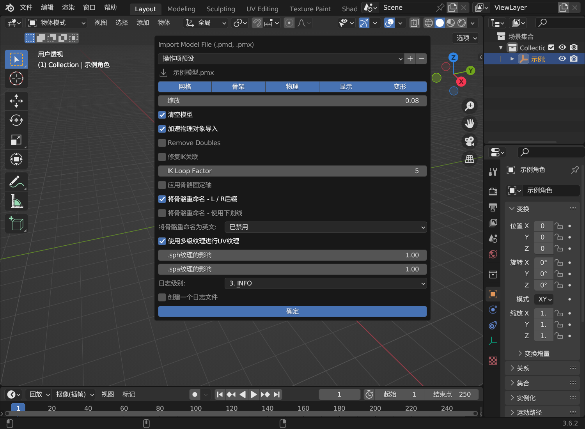
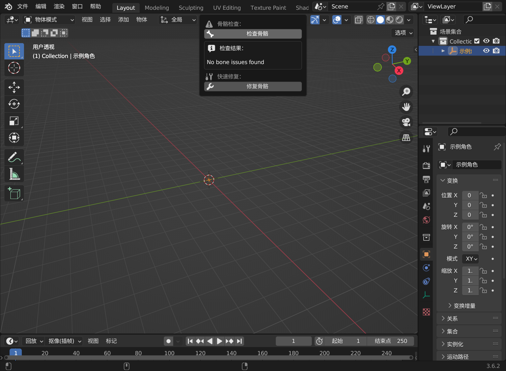
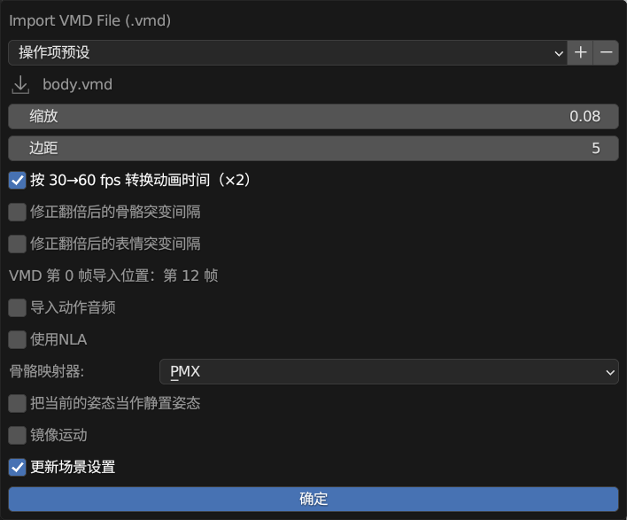
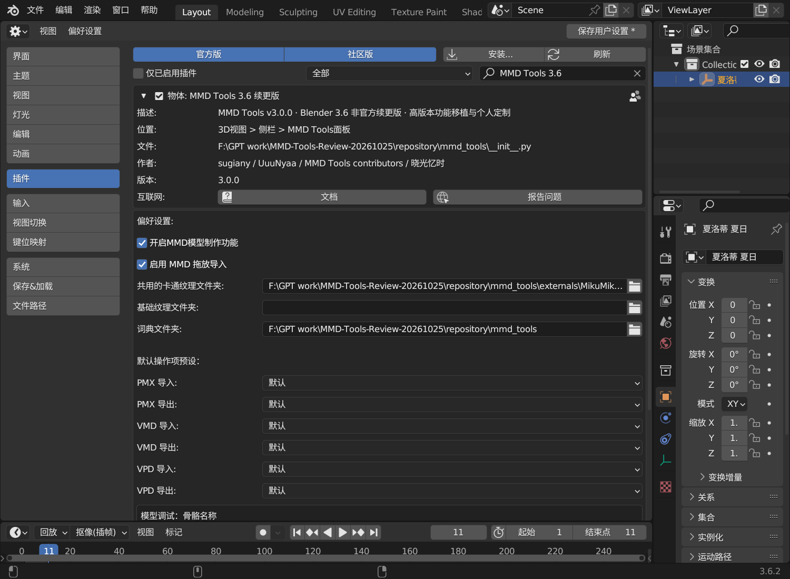
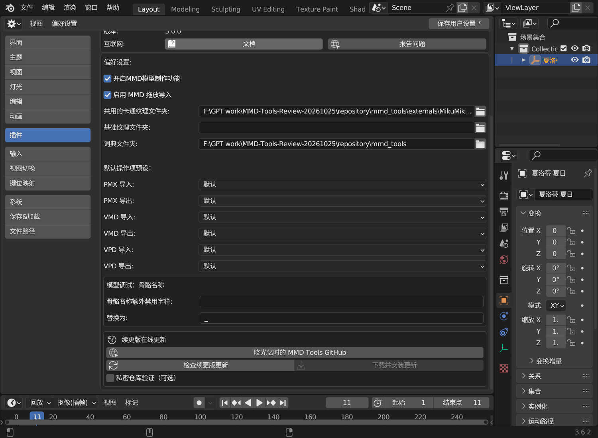

# MMD Tools 3.6 续更版

**MMD Tools v3.0.2 · 适用于 Blender 3.6 · 基于 MMD Tools 2.10.3**

发布标题：**MMD Tools 3.6 非官方续更版——高版本功能移植与个人定制**

## 这是什么插件？

MMD Tools 用于在 Blender 中导入和导出 MMD 模型、动作与姿态，例如 PMX 模型、VMD 动作和 VPD 姿态。

原版面向 Blender 3.6 的分支停止维护后，本版以 2.10.3 为基础，把部分高版本 MMD Tools 的功能移植回来，并加入制作过程中按个人使用需求编写的功能和修改。希望继续使用 Blender 3.6 的用户，可以保留熟悉的工作方式（本版没有移植最新版mmdtools的动作导入逻辑），同时使用这里列出的新增功能。

这是**非官方续更版**，不是高版本 MMD Tools 的完整移植。“个人定制”表示修改来自特定使用需求，不代表每一项都适合所有人的工作流程；三项突变间隔修正和音频导入默认关闭，旧动画清理并入人物动作导入流程自动执行。

## 与原版有什么不同？

原版的模型、材质、物理、表情和动作导入导出仍然保留，主要增加以下内容：

| 来源 | 主要内容 |
| --- | --- |
| **从高版本移植** | 默认操作预设、骨骼名称检查与修复、附加旋转修复、按贴图合并材质、表情滑块的日英名称显示、全部表情批量插帧、物理构建与清理优化、打包贴图导出、PMX 数据读取校验 |
| **参考高版本交互，在 3.6 上重新适配** | 从 Windows 资源管理器拖入 MMD 文件后，直接打开对应导入设置；内部接收方式与高版本不同 |
| **本版个人定制与修复** | VMD 导入时间 ×2（制作原生60帧视频）、可选镜头切换间隔修正、角色旧动画清理、同目录音频导入、物理对象导入提速、VMD 导入失败恢复、当前场景动画范围计算、VMD 导出部分冗余帧修复、预设保存恢复等 |

这里的“本版定制”用于区别于本项目从上游移植的部分，不表示其他插件从未实现类似功能。完整差异表和各项 GitHub 依据在文章后半部分。

**适用环境：** Blender 3.6；实际验证使用 Windows / Blender 3.6.2 + SSGI Native。拖放功能仅支持 Windows。其他系统可使用文件菜单导入，但本版未在其他系统完成验证。

## 阅读导航

- [安装与第一次导入](#start)
- [模型调试与材质合并](#model-tools)
- [动作、镜头、旧动画清理与音频](#motion-options)
- [默认操作预设](#presets)
- [附加旋转、表情及其他工具](#tools)
- [完整功能差异](#differences)
- [各项移植与高版本的实现区别](#backport-differences)
- [常见问题](#faq)

## 安装

1. 下载发布附件中的 `MMD-Tools-3.6-Continued-v3.0.2.zip` **插件安装包**，不要解压。
2. 在 Blender 的「编辑 → 偏好设置 → 插件 → 安装」中选择该 ZIP，启用 **MMD Tools 3.6 续更版**。
3. 安装或升级后重启 Blender，再打开工程。

本版沿用 `mmd_tools` 模块名，作为原版的替换版本安装，不能与另一个同名 MMD Tools 同时启用。

`Source` 源码包用于浏览代码或建立 GitHub 仓库，不是直接安装包。更新入口已连接[晓光忆时的续更版 GitHub 仓库](https://github.com/DmXgDr/mmd-tools-3.6-continued)。在插件偏好设置底部点击「检查续更版更新」，发现新版本后点击「下载并安装更新」。下载校验成功后才替换插件，原插件目录会备份；请保存工程后重启 Blender。也可以点击仓库链接手动下载。

## 第一次导入：文件菜单与拖放

可以通过「文件 → 导入」选择对应的 MMD 文件，也可以在 Windows 中从资源管理器直接拖入。拖放支持 PMX、PMD、VMD、VPD，接收区域为 3D 视图或处于「视图层」显示模式的大纲视图；拖入后直接打开对应导入设置，确认参数后执行导入。

连续的同类、同目录文件可分组处理。同一批拖入文件混有不支持格式时，整批交回 Blender 原有处理。

在「编辑 → 偏好设置 → 插件」中搜索“MMD Tools”，展开插件后，可随时关闭「启用 MMD 拖放导入」，文件菜单导入仍可使用。

### 模型

导入 `.pmx` 或 `.pmd` 模型时，不需要预先选择对象。打开导入设置后，选择需要导入的内容并确认即可。

*模型导入窗口。上方选择需要导入的网格、骨架、物理等内容；「加速物理对象导入」是本版新增选项。*

### 模型调试：骨骼名称检查与修复

选中 MMD 模型，在 3D 视图侧栏的 **MMD → 模型调试** 中点击「检查骨骼」，阅读结果后按需点击「修复骨骼」。

检查内容包括：

- 名称是否重复。
- 是否包含 CP932 无法表示的字符。
- CP932 编码后是否超过 15 字节。
- 是否包含用户指定的额外禁用字符。

检查本身不修改模型。它不是 IK、权重、穿模或物理稳定性检查；15 字节规则用于传统 MMD/VMD 名称兼容，不表示 PMX 格式本身不能保存长名称。

### 修复骨骼

点击 **修复骨骼** 后，插件按规则转换中文字形、过滤不能编码的字符、截短超长名称，并使用数字后缀处理重名。自定义禁用字符按偏好设置替换或删除。

修复只修改骨骼的 **MMD 日文名称**，不修改 Blender 骨骼名称，不重建层级、约束、权重或物理。支持 **Ctrl+Z** 撤销。修复后可以再次点击检查确认结果，再保存工程。

使用 PMX 名称映射的 VMD 会受到 MMD 骨骼改名的影响。外部动作文件不会同时改写，因此应根据模型实际用途决定是否修复名称。

### 自定义禁用字符

打开“编辑 → 偏好设置 → 插件 → MMD Tools”，找到“模型调试：骨骼名称”：

- **骨骼名称额外禁用字符**：默认留空，按每个字符检查，不是正则表达式。
- **替换为**：默认 `_`，最多一个字符；留空表示删除。

这两项是普通插件偏好设置，按 Blender 的偏好设置保存方式保留，不属于导入窗口的临时参数记忆。特殊替换组合仍可能留下名称或长度问题，可再次检查确认。

如果找不到模型调试面板，确认 MMD Tools 偏好设置中的 **Enable MMD Model Production Features / 启用 MMD 模型制作功能** 已开启。

*为便于阅读，图中单独弹出了同一个骨骼检查面板。正常入口是 MMD 侧栏的「模型调试」；示例结果为未发现名称问题。*

### 查看报告

面板显示最近一次检查或修复报告，最多 10 行。更多内容可通过 Blender 的“窗口 → 切换系统控制台”查看。报告文本使用英文，主要含义如下：

| 提示                              | 含义             |
| ------------------------------- | -------------- |
| Duplicate bone name             | MMD 骨骼名重复      |
| exceeds 15 bytes in cp932       | 编码后的名称超过 15 字节 |
| cannot be encoded in cp932      | 包含无法编码的字符      |
| additional unallowed characters | 包含自定义禁用字符      |
| No bone issues found            | 未发现本功能检查范围内的问题 |
| Fixed bone name: A -> B         | 已将名称 A 修改为 B   |

报告不会随角色选择自动更新。切换角色后请再次点击检查。

### 按贴图合并材质

移植按贴图路径合并材质的工具。用于选中网格中**只有一个图像纹理节点、且贴图路径相同**的材质，通常先**转换为 Blender 材质**再使用。

使用步骤：选中要处理的网格，在模型设置中找到「转换为 Blender 材质」旁的合并图标。确认符合条件后执行，并检查合并后的外观；不合适时撤销。

它不比较粗糙度、透明度或完整节点效果；同贴图不代表视觉效果相同。请检查候选材质后使用，操作可撤销。本版工具提示已明确这项范围。

### 人物动作和表情

先选中接收对象，再拖入 `.vmd`：

| 选中的对象 | 适用操作 |
| --- | --- |
| MMD 角色最上层根空物体 | 给整个角色导入动作与表情；自动清理旧动画，可按需启用动作音频 |
| 角色骨架 | 只向骨架导入骨骼动作 |
| 表情控制用的 `.placeholder` | 向已绑定的表情控制器导入表情 |
| 具有形态键的角色网格 | 使用原导入器向网格导入对应表情 |

`.placeholder` 由 MMD Tools 的表情绑定生成，需要先在mmdtools中装配变形。能否匹配骨骼、形态键及表情名称，仍由原导入器和模型结构决定。

没有选择对象时，VMD/VPD 拖放会提示选择接收对象；模型导入不受此限制。

### 镜头动作与姿态

镜头 VMD 可以选中实际的 **Camera 相机对象**，也可以选择上层 `MMD_Camera` 空物体，然后拖入文件。选择空物体时，点击确定会自动转选其下的实际 Camera 并导入；父子对象同时选中时只导入一次。空物体下没有相机或有多个相机、无法唯一确定目标时会提示；有多个时直接选择要导入的 Camera 即可。

VPD 姿态文件也可拖入，使用原有 VPD 导入设置。本文的 60 fps 转换和动作音频功能用于 **VMD 导入**。

## 新增导入选项

| 选项 | 公开版默认值 | 作用 |
| --- | --- | --- |
| 按 30→60 fps 转换动画时间（×2） | 当前工程实际帧率为 60 时勾选，其他情况不勾选 | 以时间线第 0 帧为基准，将本次新导入动画的关键帧与手柄时间乘 2 |
| 修正翻倍后的镜头切换间隔 | 关闭 | 选中 Camera 或能唯一找到相机的 `MMD_Camera`，且开启时间 ×2 时显示，只处理镜头动画 |
| 修正翻倍后的骨骼突变间隔 | 关闭 | 时间 ×2 后，保守识别骨骼持续跳变，将对应骨骼的后一组关键帧前移 1 帧 |
| 修正翻倍后的表情突变间隔 | 关闭 | 时间 ×2 后，保守识别表情权重持续跳变，只移动对应表情的后一关键帧 |
| 导入动作音频 | 关闭 | 查找 VMD 同目录音频并放入序列编辑器 |
| 替换已有音频 | 关闭 | 音频导入成功后删除原有声音条带；不勾选时新增到空闲音轨 |

*图中选中了角色根空物体，工程为 60 fps、边距为 5，因此 VMD 第 0 帧对应 Blender 第 12 帧。骨骼、表情修正可分别开启；人物导入不显示镜头修正。*

导入窗口按当前选中的对象显示选项：角色根空物体显示骨骼与表情修正、动作音频；骨架仅显示骨骼修正；`.placeholder` 仅显示表情修正；Camera（或能唯一找到相机的 `MMD_Camera`）仅显示镜头修正。三项间隔修正都需要先开启时间 ×2。同时选择多种目标时，显示这些目标各自适用的选项。旧动画清理自动执行，不再提供开关。

### 时间转换如何计算

***60帧处理和镜头切换间隔修正依据请先看RC的这期视频https://www.bilibili.com/video/BV153411A7aT/  4:48处开始***

例如边距为 50，原导入器把 VMD 第 0 帧放到 Blender 第 51 帧；开启转换后放到第 **102 帧**，其他关键帧及曲线手柄一起按第 0 帧缩放。窗口会显示「VMD 第 0 帧导入位置」。这个数值是源文件第 0 帧的对应位置，不保证源文件恰好在第 0 帧有关键帧。

每次打开导入窗口都会重新检查工程实际帧率（帧率除以基数），不会沿用上一个 60 fps 工程的勾选状态。24、25、30、59.94 等帧率不会自动勾选；这不是任意帧率转换工具。

**VMD 没有可用于可靠识别“已经翻倍”的帧率标记。** 如果文件本身已按 60 fps 编排，请手动取消转换，避免再次翻倍。用户指定的默认操作预设若明确保存了这个选项，则以预设为准；在本次窗口中仍可修改。

「更新场景设置」与时间 ×2 独立：勾选时，工程实际帧率已经是 60 fps 就保持不变，其他帧率统一设为 30 fps；只更新场景与刚体缓存的结束帧，保留各自的起始帧。结束帧只统计当前场景实际使用的动画，不统计其他场景和未使用的 Action。NLA 使用条带在场景中的实际结束位置，计入偏移、缩放、重复和裁剪，跳过静音或未启用的条带，并遵循独奏轨道。骨架、形态键、相机数据、材质及实例集合中的动画也会参与计算。取消此选项则保留原有帧率和范围，时间 ×2 仍按它自身的勾选状态执行。**时间转换不改变导出选项，也不会在导出时自动除以 2。**

侧栏的「设置帧范围 / Set Frame Range」使用相同规则：保持起始帧，只更新结束帧；实际 60 fps 保持不变，其余设为 30 fps。若没有可统计动画，结束帧取场景起始帧；刚体缓存结束帧不会早于它自己的起始帧。

### 镜头切换间隔修正

普通、稀疏镜头中，独立的一对关键帧只差 1 帧，翻倍后会相差 2 帧；开启修正会将后一帧前移 1 帧，并同时处理 `MMD_Camera` 与实际 Camera 的动画。

连续三帧及以上的关键帧组，以及连续逐帧烘焙段，改用位置、旋转、距离、视角及透视变化推断明显跳变，避免把切镜两侧的正常运动当成额外切镜。例如四帧中只有第 2→3 帧发生切换，就仅将第 3 帧前移；第 1、2、4 帧保留各自正常的翻倍时间，不删除关键帧，也不把后续镜头整体前移。三帧、四帧中的切镜位置并不固定，仍需逐段判断。

VMD 没有明确的“切镜”标记，推断可能与作者意图不同，因此默认关闭。确有切镜间隔问题时再开启，并检查切镜附近的播放结果。

### 骨骼与表情突变间隔修正

这是本版独有的新增功能。开启统一的时间 ×2 后，选择角色根空物体可分别开启骨骼、表情两项修正；只选骨架时仅显示骨骼修正，只选 `.placeholder` 时仅显示表情修正。两项默认关闭，关闭时间 ×2 时不显示、不执行。

它按轨道保守识别持续跳变，将翻倍后的后一关键帧前移 1 帧；骨骼位置与完整旋转通道同步，其他骨骼、表情不跟随移动。逐帧烘焙动作也能参与检测，但不会把所有相邻帧都视为切换。它不删除关键帧，也不是动作平滑或抖动清理功能；仍可能误判或漏判，使用后请检查切换附近的结果。

详细操作、帧数示例和边界说明见 [骨骼与表情突变间隔修正](docs/motion-cut-repair.md)。

### 自动清理旧动画

**选择角色根空物体或骨架导入匹配的 VMD 动作时，自动完整清理旧动画，不再提供开关。** 选根空物体时处理角色骨骼与已打帧表情；只选骨架时仅处理骨骼，保留表情。只选 `.placeholder` 导入表情时，不执行这项角色清理。误选镜头文件、空文件或完全不匹配的动作时，不会先清空原动画。批量导入时，每个目标只在遇到首个匹配文件时清理一次，同批次新导入的动作或 NLA 条带不会被后续文件再次清掉。

- 清理该角色骨骼动画通道，包括相关 NLA 条带中的骨骼动画。
- 执行姿态的「清空变换 → 全部」和「重置非关键帧」，并复位骨骼姿态。
- 选择角色根空物体时，清理角色网格及表情控制器中已参与动画的形态键通道，并把这些形态键数值归零。
- 没有动画通道、但人为设置了数值的形态键不随之归零；表情驱动绑定保留。
- 随后的 VMD 导入同样保留现有表情驱动器：它替换或添加动画 Action，不清空整个动画数据，也不解除变形绑定。导入到角色根对象时，会同时处理网格与已绑定的 `.placeholder`；驱动器仍按控制器数值工作。
- 处理共享动画/网格时尽量隔离当前角色，避免同时清理其他使用者；内部姿态复位期间暂时关闭自动插帧，完成后恢复。
- VMD 成功导入后，删除本次替换下来、已没有使用者的旧 Action 数据，避免反复导入时积累旧动作。人物、表情和镜头导入均适用；其他对象或 NLA 仍在使用的动作、勾选假用户保存的动作、标记为资产的动作以及链接库动作会保留。不批量删除工程中其他无关的未使用动作。

这是对原有覆盖导入流程的补全，会清理之前手工修改的相关动画和旧骨骼 NLA 条带。需要保留修好的动作时，先另存工程。表情驱动绑定、未打帧的表情数值继续保留。

### 动作音频

同样只在选中的角色根空物体导入动作时生效。音频来自 VMD 所在目录，而非 VMD 文件本身：

1. 优先选择与 VMD 文件主名一致的音频。
2. 没有同名音频时，目录内只有一个候选音频则使用它。
3. 无法唯一确定时跳过自动导入；可在导入窗口选择具体候选文件。

音频放在该次动作的起始偏移位置；边距和 ×2 转换都会计入，不对音频本身变速。默认在空闲音轨新增，不删除工程现有声音。多音频、音频缺失或读取失败不会把已成功导入的动作判为失败。

批量混合导入人物动作和镜头时，自动匹配音频只参考成功导入到所选角色的动作文件。没有导入匹配动画时，不导入或替换音频，也不调整工程帧率和帧范围。

只有明确勾选「替换已有音频」时，才在新音频成功建立后移除原有声音条带，**包括对白、音效及嵌套条带内的声音**；视频和其他非声音条带保留。新音频导入失败时保留原有声音。

## 默认预设与本次会话记忆

在导入/导出窗口中调整选项后，可通过顶部操作项预设的 `+` 保存自己的预设。随后在「偏好设置 → 插件 → MMD Tools → 默认操作项预设」中，为 PMX、VMD、VPD 的导入/导出分别指定默认预设。

- 默认选择按预设名称保存，不因列表排序变化而串到其他项。
- 选择信息与选中预设的内容备份保存在 Blender 用户配置目录的 `mmd_tools_public/default_operator_presets.json`，替换插件代码后仍可恢复。
- 拖放窗口中成功导入使用的其他参数在当前 Blender 会话内记忆；重新启动后重新从默认预设/内置值开始。
- 修改默认预设会让下一次调用重新读取预设。时间转换选项每次按场景重新计算，除非预设明确指定它。

*插件偏好设置：六项操作预设均为「默认」。路径随安装位置变化，不需要照抄图中的路径。*

本版不会删除用户已经创建的预设文件；升级用户可能仍会在列表中看到自己以前保存的预设。若希望恢复内置行为，把六项默认操作预设改回「默认」。

## 其他功能的详细用法

### 附加旋转修复

这部分的作用可以看rint大佬的专栏

https://www.bilibili.com/opus/1131140862183473152

https://www.bilibili.com/opus/1136168885950611460

移植高版本附加旋转约束的相关处理，MMD 骨骼可以继承其他骨骼的一部分旋转，这类关系常称为“赋予亲”或“附加旋转”。本插件修正多轴旋转叠加和负赋予率抵消时的组合方式。

新导入的模型自动使用修正后的约束，不需要额外点击按钮。

已经保存的**旧模型**可使用模型工具中的「**修复旧模型赋予亲**」更新已有约束，无需重新导入整个角色。

使用步骤：

1. 选中需要处理的 MMD 角色。
2. 打开 MMD 侧栏中的模型设置，在组装相关区域找到「修复旧模型赋予亲」。
3. 点击修复后，检查原先异常的旋转帧；已有约束会被更新，无需删除整个模型。

这与上述骨骼名称检查是两个独立功能。它不修正 VMD 与角色骨骼命名不匹配，也不是重新绑定动作。

### 表情滑块与批量插帧

移植高版本的表情滑块布局、日文/英文名称显示开关，以及「为全部表情注册关键帧」操作。先完成 MMD 表情绑定，再在相应表情面板调整和插帧。

使用步骤：

1. 选中角色，在模型设置的组装区域点击「变形 / Morph」完成表情绑定。
2. 在 MMD 表情面板选择表情、调整滑块数值，按需开启日文名或英文名显示。
3. 将时间线移动到需要插帧的位置，执行「Register All Morphs / 为全部表情注册关键帧」。若面板中不易找到，也可用 F3 搜索英文操作名称。
4. 按 F9 打开最后操作设置，可勾选「Skip Unchanged / 跳过未变化」并调整容差。

“全部表情”针对已绑定的表情控制滑块，包含可通过该系统控制的不同表情类型，不是给所有网格形态键无条件插帧。操作后可通过 F9 调整「跳过未变化」及容差。

### 导入失败时恢复旧动画

导入 VMD 过程中发生错误时，插件会恢复本次操作开始前的动作、NLA 条带、骨骼姿态和表情值，保留原有表情驱动；相机导入失败时也恢复父级、相机设置及原驱动。场景帧率、起止帧和对象选择随之恢复。成功导入后的使用方式不变，无需打开额外开关。

一次选择多个 VMD 时，以整批为单位恢复。例如第一个文件已经导入、第二个文件读取失败，会恢复到这一批导入之前。被替换且无人使用的旧 Action 会在整批成功后再删除；有其他使用者、手动保留、资产或链接动作继续保留。

此恢复处理针对插件能捕获的导入错误，不替代工程保存，也不能恢复 Blender 进程直接退出。音频导入仍独立处理：音频失败时跳过音频，保留成功导入的动作。

### 模型导入提速

新增「加速物理对象导入」选项，默认启用。通过复用创建模板和批量构建减少刚体、关节创建过程的开销，目标是保留物理参数、对象归属及模型数据。它不是物理简化或烘焙，也不承诺播放、渲染速度提升。遇到特殊模型时可关闭此选项使用常规创建路径。

如果使用新版mmd桥流程，我建议导入模型时直接取消选择 **物理** 选项

### 物理构建、清理与显示

照常使用 MMD 面板中的物理「构建 / Build」「清理 / Clean」及刚体、关节显示开关，无需额外配置。构建会临时切换到**刚体缓存的起始帧**处理物理，再返回原先所在帧；没有刚体缓存时使用场景起始帧。构建或清理发生错误时，刚体世界会恢复操作前的启用状态。

本版加快了非碰撞约束生成、模型层级遍历、批量显隐与临时对象清理。同时修复部分旧工程在物理构建后留下失效关节内部引用的问题。刷新时保留关节对象、参数、动画、驱动及物理世界顺序。它保留模型的刚体和关节参数，不是物理简化功能，也不改变物理求解器。这些处理参考高版本实现；临时数据释放采用 Blender 3.6 专用适配，避免直接照搬新版本依赖的删除行为。

### 导出工程内打包的贴图

选中模型，通过「文件 → 导出 → MikuMikuDance Model (.pmx)」导出，勾选**复制贴图 / Copy Textures**。基础贴图、球面贴图及非共享 Toon 贴图若已打包在 `.blend` 中，会随 PMX 写出；磁盘原文件缺失也可使用打包内容。

插件使用材质节点实际引用的图像，不按图像名称猜测。两个图像即使具有相同原路径，也会按各自内容分别导出，遇到目标重名时使用后缀区分。导出不解包或修改原工程内的图像。未打包且磁盘文件已丢失的贴图仍无法补回；不勾选「复制贴图」时不自动写出贴图文件。

### PMX 文件读取校验

PMX 文件中的字符串长度或记录数量为负数、数据提前结束等情况，会显示导入错误并停止读取。插件不会自动猜测缺失数据，也不会把读了一部分的模型当作成功导入。正常模型的格式支持范围不变。

### VPD 姿态与姿态库

选择角色根对象或骨架后，通过「文件 → 导入 → Vocaloid Pose Data (.vpd)」或拖放导入姿态。姿态显示在角色上，同时保存在该骨架的 **MMD 姿态库** 中，随 `.blend` 工程保存；不会替换角色当前的动作或 NLA 动画。

导出 VPD 时可选择：

- **当前姿态**：导出角色现在的姿态。
- **活动姿态**：指定 MMD 姿态库，并在「导出姿态」中选择其中一个姿态。
- **全部姿态**：将库中各个姿态分别导出到所选文件夹，文件名为「序号_姿态名称.vpd」，避免同名覆盖。

没有可用姿态库时，活动/全部姿态导出会提示错误；可先导入 VPD，或指定带有姿态标记的 Action。旧工程中的姿态 Action 如果仍在，可在导出窗口的「MMD 姿态库」中重新指定。姿态库也可用于「从姿态库覆盖骨骼表情」及 PMX 导出的对应选项。

这是本版针对 Blender 3.6 已移除旧姿态库接口的兼容修复，保留独立姿态库工作方式；没有改成高版本将姿态写入当前动画的流程。

### VMD 导出冗余帧修复

修正原导出器在部分恒定区间多插入“结束前一帧”的情况：仅在该通道数值确实变化、需要表示跳变时保留相应补帧。适用于使用该公共曲线转换路径的相机、骨骼和表情导出。

这不是动作简化器，不会随意删除用户关键帧，也不移除表达真实跳变或曲线插值所必需的采样。因此导出关键帧数仍可能与 Blender 界面显示的数量不同。之前已经导出到 VMD 的冗余帧不会被自动认定并删除。

## 与原版 2.10.3 的全部功能差异

下表以原始 2.10.3 为比较基线。“本分支新增/修复”表示本分支的定制实现，不表示其他软件从未提供类似功能。实现文件与上游依据见 [来源与移植说明](docs/UPSTREAM.md)。

| 差异 | 来源归类 | 本版范围 |
| --- | --- | --- |
| VPD 姿态库兼容修复 | 本版修复 | 使用独立 Action 保存姿态，恢复姿态导入、库中姿态导出和骨骼表情转换；不替换当前动作 |
| PMX/VMD/VPD 六项默认操作预设 | 高版本移植 + 本版扩展 | 移植偏好设置和预设应用；增加按名称持久保存、备份恢复、立即切换和旧字段兼容 |
| 拖入后直接使用导入设置窗口 | 参考高版本交互 + 本版适配 | Windows/Blender 3.6 接收层、队列、会话参数记忆、开关；不依赖 Blender 4.5 FileHandler API |
| 骨骼名称检查与修复 | 高版本部分移植 | 仅骨骼；含额外字符替换后避免重名的修复及所需 OpenCC 数据 |
| 附加旋转计算修复 | 高版本移植 + 3.6 适配 | 约束逻辑修正及旧模型更新入口 |
| 按贴图合并材质 | 高版本移植 | 同贴图路径、单图像节点规则；增加明确的使用范围提示 |
| 表情滑块及日英名称显示 | 高版本移植 | 集成滑块交互和相关显示修正 |
| 全部表情批量插帧 | 高版本移植 | 已绑定表情控制器，含跳过未变化选项 |
| VMD 导入 30→60 时间转换 | 本分支新增 | 源帧及手柄时间 ×2；边距计入；按场景帧率决定初始勾选 |
| 骨骼与表情突变间隔修正 | 本分支新增 | 时间 ×2 时分别选择；保守识别持续跳变，按骨骼或表情轨道前移后一关键帧；支持逐帧烘焙数据 |
| 镜头翻倍后的切换间隔修正 | 本分支新增 | 稀疏镜头按间隔，密集烘焙段按跳变推断；独立、默认关闭 |
| 根对象／骨架导入前自动完整清理旧动画 | 本分支新增 | 根对象清理骨骼、相关 NLA 和已动画化表情；骨架只清理骨骼；保护表情驱动、未动画化的形态键数值及共享使用者 |
| 动作同目录音频导入 | 本分支新增 | 同名/唯一候选匹配；歧义跳过；新增音轨或明确替换；失败不阻断动作 |
| 物理对象创建提速 | 本分支新增 | PMX/PMD 导入的创建开销优化，有常规路径开关 |
| 物理构建、清理及显隐优化 | 高版本移植 + 3.6 适配 | 缓存起始帧构建、异常恢复刚体世界状态、层级及批量处理提速、安全释放临时物理数据 |
| VMD 导入失败恢复 | 本分支新增 | 整批失败后恢复原动画、NLA、姿态、表情、相机及场景设置，成功后再处理旧 Action |
| 当前场景动画范围计算 | 本分支修复 | 排除其他场景和未使用动作，按实际 NLA 条带计算；菜单和侧栏统一只改结束帧，保留 60 fps |
| PMX 打包贴图导出 | 高版本移植 + 3.6 适配 | 复制贴图时使用材质实际图像引用，支持打包图像和同路径不同图像 |
| PMX 读取校验 | 高版本移植 | 拒绝负数长度、负数数量和截断数据 |
| VMD 导出部分冗余补帧修复 | 本分支修复 | 恒定区间补帧条件修正，保留必要跳变和采样 |
| 清理动作时的自动插帧兼容修复 | 本分支修复 | 内部重置期间临时停用自动插帧，随后恢复设置 |
| Blender 3.6 注册、翻译及接口适配 | 移植配套 | 维持 3.6 插件注册与界面，附带依赖和许可证 |

标准 PMX/PMD 模型导入、PMX 导出、VMD/VPD 导入导出、MMD 材质、物理、表情绑定、原有 NLA 等能力来自原版，不是本版新增。

## 移植功能与高版本实现有什么不同？

原有移植功能参考 **MMD Tools v4.5.14**；3.0.2 另外移植了后续物理优化等指定提交，具体版本与链接见[来源说明](docs/UPSTREAM.md)。这里的“移植”只针对列出的功能，不保证和后续上游版本的所有行为一致。

| 功能 | 本版保留的使用方式 | 为 Blender 3.6 所做的适配与范围差异 |
| --- | --- | --- |
| 拖放导入 | 拖入文件后弹出对应的导入设置，确认后调用导入器 | 高版本使用 Blender FileHandler；3.6 没有此接口，本版采用 Windows OLE 接收层，把导入操作排入 Blender 主线程执行。仅支持 Windows，导入引擎仍基于 2.10.3；没有移植高版本整套动作合并、当前帧起点逻辑 |
| 默认操作预设 | 在偏好设置中分别指定六种导入/导出默认预设 | 保留预设值读取方式，增加按名称保存选择和内容备份；兼容菜单与拖放两类预设路径。拖放会话记忆以及根据场景初始化时间转换属于本版补充 |
| 骨骼名称检查修复 | 先检查结果，再手动修复名称 | 只移植骨骼部分，沿用 2.10.3 的模型对象接口并附带 OpenCC 依赖；不提供高版本的模型、表情、贴图全套检查，也不在导入时自动检查 |
| 附加旋转修复 | 使用修正后的附加旋转关系 | 将旋转混合与欧拉顺序相关修正适配到旧版骨骼约束结构；没有替换为高版本整套骨骼系统。另提供旧工程的「修复旧模型赋予亲」入口 |
| 按贴图合并材质 | 对满足条件的材质按图像路径分组、合并 | 沿用单图像纹理节点与相同路径的限制；入口接入 3.6 面板，不是移植高版本整套材质系统。本版额外说明它不会判断材质外观是否相同 |
| 表情滑块与名称显示 | 显示表情控制滑块，切换日文/英文名称 | 接入 2.10.3 的模型属性、表情绑定及 `.placeholder` 控制结构；不将高版本全部面板布局照搬到 3.6 |
| 全部表情批量插帧 | 当前帧插入已绑定表情的关键帧，支持跳过未变化 | 在旧版 MorphSlider 上补充遍历能力，再接入批量插帧操作。处理的是绑定后的控制通道，不是遍历工程中所有模型的形态键 |

物理优化保留 2.10.3 中「匹配到节点后不再继续处理其后代」的模型筛选规则；使用 Blender 3.6 的物理释放接口后再批量删除，未照搬依赖较新 Blender 内核的删除捷径。构建和清理只保证恢复刚体世界开关及构建前的当前帧，不声称能在任意错误后完整还原半成品物理结构；需要时可撤销操作。

打包贴图导出接入 2.10.3 的贴图路径及材质接口，读取实际 Image 中的原始打包字节；PMX 读取校验补充读取长度和数量检查，没有整体更换为新版 PMX 解析器。VMD 失败恢复与当前场景/NLA 范围计算属于本版补充，不是新版动作导入合并流程的移植。

例如，骨骼检查中的“15 字节”是 VMD 名称匹配所涉及的 CP932 编码长度，不是 15 个汉字；材质合并中的“同贴图”指路径匹配，不是图像内容比较。名字相近的功能也应按这些具体范围使用。

[查看每项移植的 GitHub PR、提交及本版实现文件](docs/UPSTREAM.md)。

## 在线更新

更新来源固定为 [DmXgDr/mmd-tools-3.6-continued](https://github.com/DmXgDr/mmd-tools-3.6-continued) 的正式 Releases，不会再更新到上游分支。检查更新不会自动安装，也不会在 Blender 启动时自动联网。程序核对版本、Blender 3.6 兼容标记、安装包结构和 SHA-256；没有新版本或校验失败时不替换当前插件。

遇到网络问题时，可前往 [Releases 发布页面](https://github.com/DmXgDr/mmd-tools-3.6-continued/releases) 手动下载安装包。

更新完成会提示重启。旧插件备份位于插件目录旁的 `.mmd-backup-日期时间-随机后缀` 文件夹；自动更新不修改用户的预设保存目录。

## 常见问题

**v3.0.2 与原版 2.10.3 是什么关系？**

**MMD Tools v3.0.2** 是本非官方续更版的发行编号，插件详情、安装包和文档均使用这个版本号。代码基于原版 2.10.3，并移植本文列出的高版本功能；它不代表上游官方发布了一个同名版本。适用的 Blender 版本仍为 3.6。

**拖入文件没有出现窗口？**

确认拖放开关开启，拖入 3D 视图或视图层大纲，并在导入 VMD/VPD 前选好对象。其他接管同一格式的拖放插件可能冲突，可关闭本版拖放改用文件菜单。Windows 下 Blender 与资源管理器权限不同也会影响拖放。

**改了预设，下一次仍是刚才的参数？**

同一次会话的成功导入参数会被记住；切换默认预设会重新应用预设。若自己保存的预设明确固定了时间转换选项，它会覆盖自动帧率判断。把默认预设改回「默认」即可回到内置行为。

**为什么没有更多的模型自动修复？**

本版只提供上述已移植的骨骼名称检查，不包含全面模型验证。角色结构、动作名称映射、物理和材质仍需按实际模型检查。

## 兼容性与反馈

适用环境和功能边界见 [兼容范围](docs/VALIDATION.md)。不同工程、渲染器和第三方插件组合可能存在差异。

反馈问题请提供 Blender 完整版本、本插件发布号、操作步骤、报错文字、选中的对象类型，以及可分享的最小复现文件。若不能分享工程，说明是否使用 NLA、约束、第三方插件和自定义预设。

## 作者与来源

- **原作者及上游贡献者：** sugiany / UuuNyaa / MMD Tools 项目贡献者。
- **本续更版的功能移植、个人定制与维护：** 晓光忆时。
- **基础分支：** [UuuNyaa's forked version](https://github.com/UuuNyaa/blender_mmd_tools)，以 MMD Tools 2.10.3 为基础；高版本功能的来源逐项列在 [移植依据](docs/UPSTREAM.md) 中。

“UuuNyaa's forked version”表示分支来源，作者栏列出作者和贡献者名称。本版保留原有版权、署名及第三方许可。

## 许可证与致谢

保留 MMD Tools 原有版权及 [GNU GPL v3 许可证](LICENSE)。感谢 [MMD-Blender/blender_mmd_tools](https://github.com/MMD-Blender/blender_mmd_tools) 及原项目贡献者。OpenCC 相关实现、数据及许可保留在插件的 `_vendor` 与 `data/opencc` 目录；具体第三方许可见对应文件。
